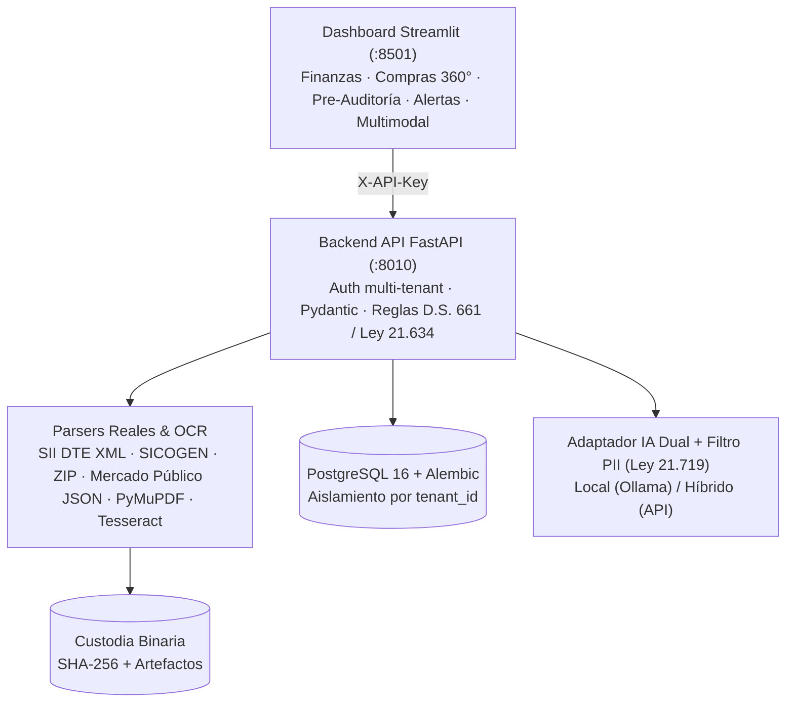

# MunicipalGuard AI · v0.3.1

**Plataforma multiinstitucional de auditoría financiera continua, ingesta multimodal con OCR y revisión preventiva de bases de licitación bajo la normativa chilena.**  
*Multi-tenant platform for continuous municipal financial auditing, OCR multimodal ingestion, and pre-publication tender compliance review under Chilean public procurement law.*

[Ver documentación interactiva y tutorial (HTML ES/EN)](https://plulion.github.io/municipalguard-ai/)

---

## Español

### Qué hace MunicipalGuard AI
1. **Finanzas Multiformato Real:** importa facturas y notas de crédito electrónicas del **SII (`XML` DTE 33/34/56/61)**, lotes masivos **`ZIP`** (hasta 200 archivos), informes contables **CGR SICOGEN (`XML`/`TXT`)**, SII RCV, cartolas bancarias (`XLSX`, `XLS`, `CSV`, `TSV`, `TXT` en UTF-8/Latin-1), `JSON` y decretos/facturas en `PDF`/`JPG`/`PNG` con OCR en español.
2. **Compras Públicas y Vista Proveedor 360°:** integra licitaciones y órdenes de compra desde planillas o **`JSON` de Datos Abiertos de Mercado Público**, consolidando adjudicaciones, órdenes y pagos financieros por RUT normalizado (módulo 11).
3. **Auditoría Previa de Bases (Pre-Publicación):** valida borradores en `PDF`, `DOCX`, `JPG`, `PNG` o `TXT` contra la **Ley 19.886**, **Ley 21.634** y **D.S. 661/2024** (tramos UTM `L1/LE/LP/LR`, plazos mínimos, cierre en lunes/post-feriado desde las 15:00 hrs, tope de multas 30%, garantías 3%/5%, ponderaciones al 100%, citas obsoletas al D.S. 250 y marcas sin *"o equivalente"*).
4. **Alertas con Trazabilidad Humana:** detecta posibles facturas duplicadas entre meses, desviaciones presupuestarias, oferta única, adjudicaciones sin ofertas y órdenes de compra que exceden el monto adjudicado, manteniendo bitácora inmutable de cambios de estado.
5. **Motor IA Dual + Privacidad (Ley 21.719):** opera **100% local** (`AI_PROVIDER=local` con Ollama + Tesseract OCR) o en modo **híbrido** (`AI_PROVIDER=hybrid`) con enmascaramiento previo de datos personales (PII).

### Arquitectura


### Arranque rápido con Docker
```bash
docker compose build api
docker compose up --build -d
```
* **Dashboard:** `http://127.0.0.1:8501`
* **API Health:** `http://127.0.0.1:8010/health`
* **Pruebas automatizadas:** `pytest -v` (21 pruebas en verde)

---

## English

### What MunicipalGuard AI Does
1. **Real-World Financial Ingestion:** natively parses Chilean **SII electronic invoices (`XML` DTE 33/34/56/61)**, batch **`ZIP`** archives (up to 200 files), **CGR SICOGEN** accounting XML/TXT, bank statements (`XLSX`, `XLS`, `CSV`, `TSV`, `TXT` in UTF-8/Latin-1), `JSON`, and `PDF`/`JPG`/`PNG` payment decrees via Spanish OCR.
2. **Public Procurement & Supplier 360°:** imports tenders and purchase orders from spreadsheets or **Mercado Público Open Data `JSON`**, consolidating awards, purchase orders, and actual financial payments by validated Chilean Tax ID (RUT).
3. **Pre-Publication Tender Audit:** reviews draft bidding documents (`PDF`, `DOCX`, `JPG`, `PNG`, `TXT`) against **Law 19.886**, **Law 21.634**, and **Decree 661/2024** (UTM brackets `L1/LE/LP/LR`, statutory publication windows, Monday/post-holiday 15:00 closing rule, 30% penalty cap, 3%/5% guarantees, 100% weight sum, outdated Decree 250 citations, and restrictive brand clauses).
4. **Human-in-the-Loop Risk Alerts:** flags cross-month duplicate invoices, budget overruns, single-bidder awards, zero-offer awards, and purchase orders exceeding awarded amounts, with an immutable status audit log.
5. **Dual AI Engine & Privacy (Law 21.719):** runs **100% local** (`AI_PROVIDER=local` via Ollama + Tesseract OCR) or **hybrid** (`AI_PROVIDER=hybrid`) with automatic PII redaction before external calls.

### Format Compatibility Matrix

| Domain | Accepted Formats | Standards Covered |
| :--- | :--- | :--- |
| **Finance** | `.xml`, `.zip`, `.xlsx`, `.xls`, `.csv`, `.tsv`, `.txt`, `.json`, `.pdf`, `.jpg`, `.png` | SII DTE (XXE-protected), CGR SICOGEN, SII RCV, Bank Statements, Municipal ERPs |
| **Procurement** | `.csv`, `.xlsx`, `.xls`, `.tsv`, `.txt`, `.json`, `.xml` | Mercado Público Open Data JSON, ChileCompra spreadsheets |
| **Pre-Audit & Docs** | `.pdf`, `.docx`, `.jpg`, `.jpeg`, `.png`, `.webp`, `.txt` | Native PDF, Scanned PDF + OCR, Mobile photos, Word documents |

> **Governance notice:** Alerts and pre-audit findings are decision-support signals requiring human review. Before processing production personal data, enable nominal RBAC authentication and conduct a Law 21.719 impact assessment.
